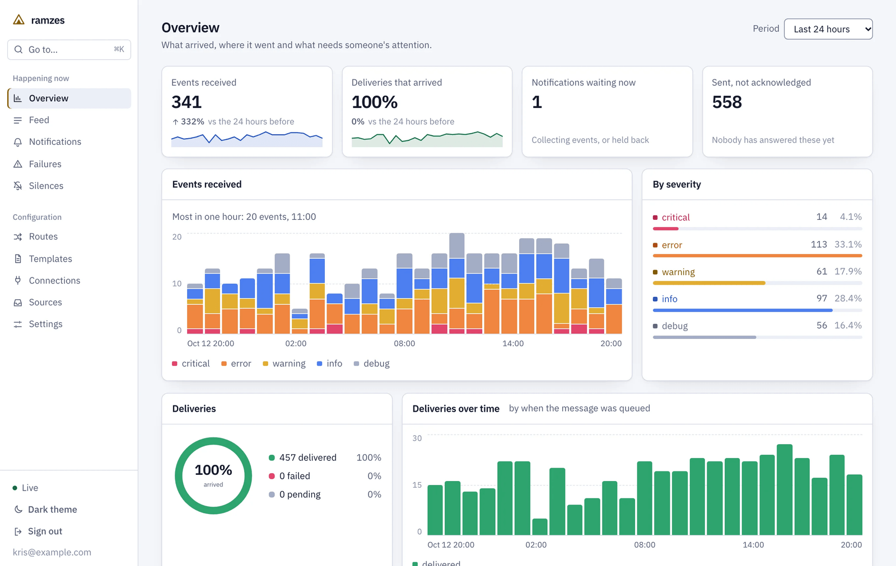

<a href="https://softberries.github.io/ramzes/">
  <picture>
    <source media="(prefers-color-scheme: dark)" srcset="docs/assets/overview-dark.png">
    <source media="(prefers-color-scheme: light)" srcset="docs/assets/overview-light.png">
    
  </picture>
</a>

<p align="center">
  <a href="LICENSE"></a>
  <a href="https://github.com/softberries/ramzes/actions/workflows/ci.yml"></a>
  <a href="https://softberries.github.io/ramzes/"></a>
</p>

<p align="center">
  <a href="https://softberries.github.io/ramzes/getting-started/quickstart/"><b>Quickstart</b></a> ·
  <a href="https://softberries.github.io/ramzes/"><b>Documentation</b></a> ·
  <a href="https://softberries.github.io/ramzes/guide/tour/"><b>Tour of the app</b></a> ·
  <a href="https://softberries.github.io/ramzes/verified/"><b>Verified claims</b></a>
</p>

**ramzes is a self-hosted notification router.** Your services send events to one HTTP endpoint, and routes decide who is told, on which channel and how often. Duplicates are counted instead of repeated, bursts are grouped into one message, messages can wait out quiet hours, and what nobody acknowledges is escalated. For every event you can see which routes matched and what each delivery attempt answered. ramzes is one Rust binary with a web UI inside it, stores in SQLite or Postgres, and is licensed under the AGPLv3.

> **Status.** All of the design is built and tested, but nothing is released yet, and no channel or source has been run against its live service: request formats follow each service's documentation and are pinned by tests. [Verified claims](https://softberries.github.io/ramzes/verified/) says exactly what was checked and how.

## Features

- **[Routes](https://softberries.github.io/ramzes/concepts/routes/).** Match on topic, severity, source, labels or an expression over the payload such as `payload.amount > 100 and labels.env == 'prod'`. The route tester shows what every route would do with an event, including routes you have not saved.
- **[Noise control](https://softberries.github.io/ramzes/concepts/noise-control/).** Per route: dedup, grouping, quiet hours in a time zone and a rate limit. Silences mute matching events on every route.
- **[Escalation and acknowledgement](https://softberries.github.io/ramzes/concepts/escalation/).** Tell someone else when nobody acknowledges in time. Acknowledge from the UI, the API, a link in the message or a button in Slack.
- **[Sources](https://softberries.github.io/ramzes/sending/events-api/).** A JSON API for your own services, and webhook addresses for Alertmanager, Grafana, GitHub, GitLab, Sentry and any other JSON, mapped in the UI.
- **[Channels](https://softberries.github.io/ramzes/channels/overview/).** Slack (webhook or app), Microsoft Teams, Discord, email, ntfy, Telegram, Pushover, PagerDuty, Opsgenie, a signed webhook, and your own connector written as YAML.
- **[Delivery](https://softberries.github.io/ramzes/concepts/delivery/).** An event is acknowledged only after it is stored. Deliveries retry with backoff, a connection that keeps failing is paused, and failures can be sent again in bulk.
- **[A UI for what happened](https://softberries.github.io/ramzes/guide/tour/).** An overview with charts, a live feed, the journey of each event, open notifications, failures and silences, in a dark and a light theme.
- **[Configuration as data](https://softberries.github.io/ramzes/operations/backup/).** Every change is kept with a diff and can be rolled back; `ramzes export` and `ramzes import` move a configuration between instances.

## Quickstart

There is no published image yet, so ramzes is built from a checkout. With Docker:

```sh
git clone https://github.com/softberries/ramzes.git && cd ramzes
docker compose -f deploy/compose.yaml up --build
```

Open <http://localhost:7269>. The setup screen creates your account, a source, a connection and a first route. From source instead (Rust 1.98 and Node 24):

```sh
make build
./target/release/ramzes
```

Then send an event with the source key the setup screen gave you:

```sh
curl -X POST http://localhost:7269/v1/events \
  -H "Authorization: Bearer <source key>" \
  -H "Content-Type: application/json" \
  -d '{"topic": "orders.failed", "title": "Order 7 failed", "severity": "error",
       "labels": {"env": "prod"}, "payload": {"order": 7}}'
```

The answer is `202` once the event is stored. [Quickstart →](https://softberries.github.io/ramzes/getting-started/quickstart/)

## Documentation

| | |
|---|---|
| [Getting started](https://softberries.github.io/ramzes/getting-started/what-is-ramzes/) | What ramzes is, the quickstart, a first route |
| [Install](https://softberries.github.io/ramzes/install/docker-compose/) | Docker Compose, Helm, from source, upgrading |
| [Concepts](https://softberries.github.io/ramzes/concepts/architecture/) | Events, routes, notifications, noise control, escalation, delivery, templates |
| [Sending events](https://softberries.github.io/ramzes/sending/events-api/) | The events API and each built-in source |
| [Channels](https://softberries.github.io/ramzes/channels/overview/) | Each connector, and writing your own |
| [Operations](https://softberries.github.io/ramzes/operations/configuration/) | Configuration, security, backup, metrics, retention, troubleshooting |
| [Reference](https://softberries.github.io/ramzes/reference/api/) | Admin API, expressions, connector definitions, source mappings |
| [Limits](https://softberries.github.io/ramzes/limits/) | What is not built: several instances, roles, single sign-on, an audit log |

## Development

```sh
make test       # Rust tests on SQLite
make test-pg    # the same tests on SQLite and on a throwaway Postgres in Docker
make lint       # rustfmt and clippy
make ui-test    # lint, type check and unit tests of the web UI
make e2e        # browser tests against the real binary
```

The documentation site is in `site/` (`npm ci && npm run dev`). See [CONTRIBUTING.md](CONTRIBUTING.md) before opening a pull request, and [SECURITY.md](SECURITY.md) to report a vulnerability.

## License

The core is licensed under the [GNU Affero General Public License v3.0](LICENSE). A commercial edition is planned; see [LICENSING.md](LICENSING.md) or write to [hello@softberries.dev](mailto:hello@softberries.dev).
